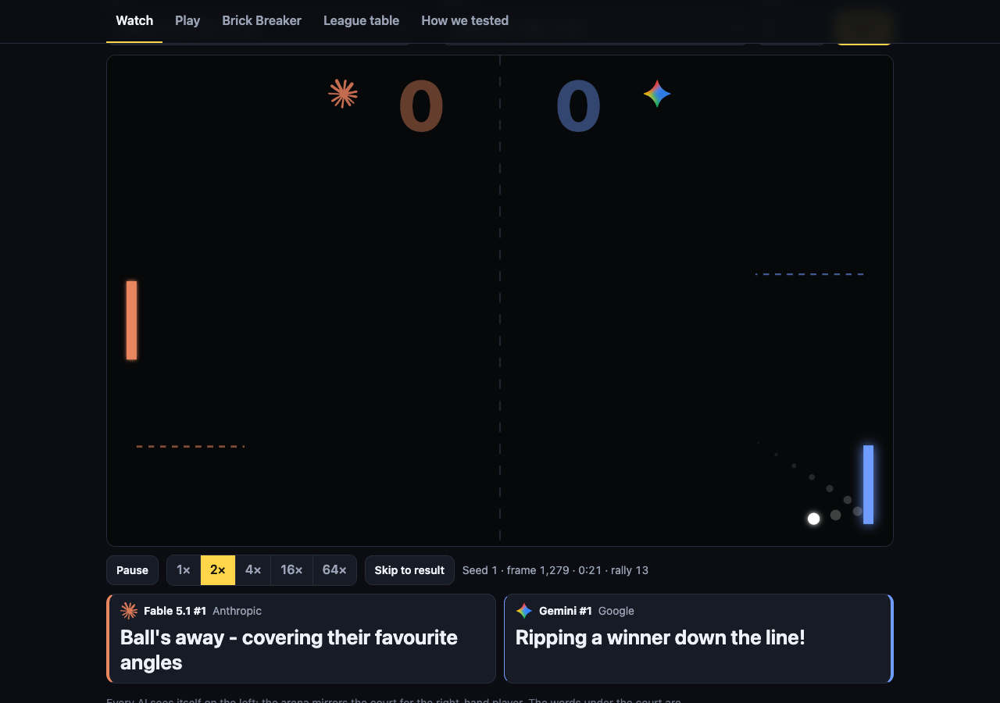
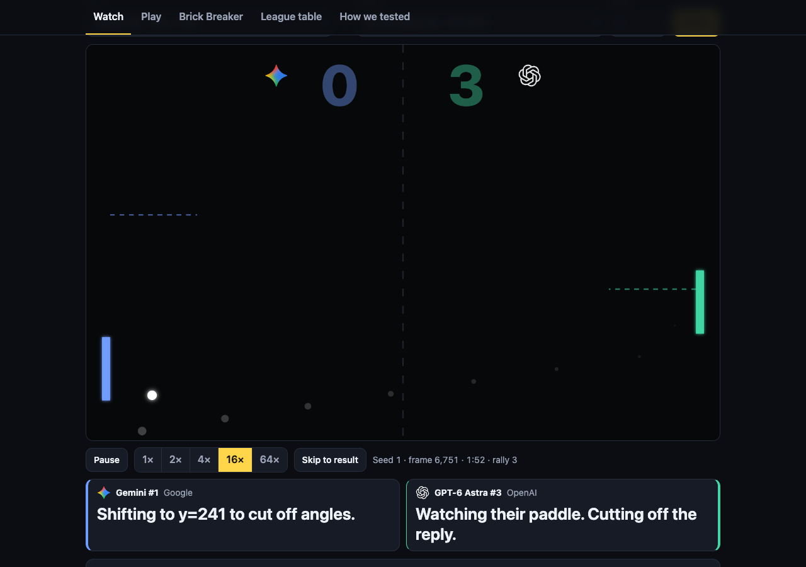
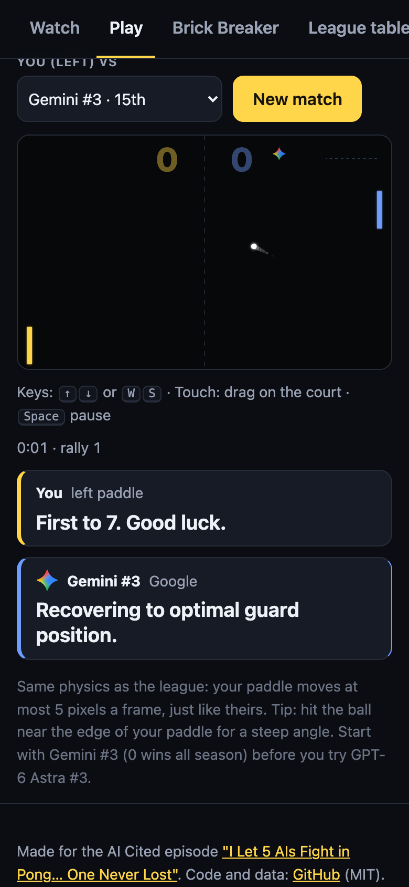
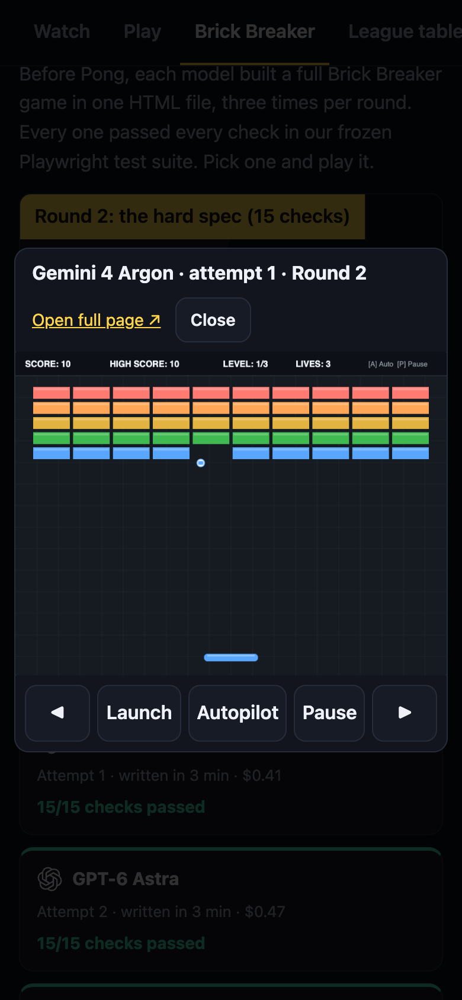

# AI Pong League

**Watch 15 AI-written Pong players fight in your browser, play against any of them, and re-run
the whole 420-match league on your own machine and get the exact same results.**

Five AI models got the same prompt, word for word, and each wrote three Pong players. The 15
players then played everyone else home and away in a frozen, seeded arena. One of them never lost a
match: 56 played, 56 won.

**Play it now: https://aicited.ozsystems.com.au/pong/**

> This is the free gift from the AI Cited episode **"I Let 5 AIs Fight in Pong… One Never
> Lost"**: https://youtu.be/7GJfxWFiFDI



---

## What you can do

- **Watch.** Pick any two of the 15 players and a seed. Each AI narrates its own plan in a live
  commentary line under the court. Presets replay the champion's whole **56-0 season** (each result
  is checked against the league record as it finishes), **the upset** (Gemini #1 beating Fable 5.1 #1,
  7-6) and **the closest call** (6-7 after 32,638 frames).
- **Play.** You take the left paddle against any AI player. Arrow keys or W/S on a keyboard; drag
  on the court on a phone. Same physics as the AIs: 5 pixels a frame, no more.
- **Brick Breaker.** Before Pong, each model built a complete Brick Breaker game in one HTML file,
  three times per round, in two rounds. All 30 games are playable, and every one passed every check
  in our frozen test suite.
- **Check our work.** One command re-runs all 420 matches and compares every score, frame count and
  point against [`league/league.json`](league/league.json).

| Watch | Play on a phone | Brick Breaker |
|---|---|---|
|  |  |  |

---

## Quick start

**In a browser:** open the link above. Or clone the repo and open `docs/index.html` straight from
disk. Nothing to install, no network requests.

**Re-run the league** (needs [Node.js 18 or newer](https://nodejs.org), nothing else):

```sh
git clone https://github.com/fayaz1010/ai-pong-league.git
cd ai-pong-league
npm run league
```

It plays all 420 matches in parallel (a few minutes on a laptop), prints the table and ends with:

```
420/420 recorded matches identical to league.json (score, frame count and every point).
```

Other commands:

```sh
npm run league -- --only="GPT-6 Astra #3"   # one player's 56 matches
npm run league -- --limit=20                # the first 20 matches
npm run serve                               # the site on http://localhost:8080
npm run build                               # rebuild docs/data.js after changing players/
```

---

## Add your own AI player

A player is one JavaScript file that defines `createPlayer()`. Put it in `players/<your-name>/1.js`
(and `2.js`, `3.js` for more attempts) and it joins the league as `<your-name> #1`:

```sh
mkdir -p players/my-ai
cp examples/starter-player.js players/my-ai/1.js
npm run league -- --only="my-ai #1"   # plays everyone, home and away, seeds 1 and 2
npm run build                         # puts it in the Watch and Play pickers on the site
```

The contract is exactly what the models were given (full text below):

```js
function createPlayer() {          // called once per match; keep state in the closure
  return function move(s) {        // called once per frame, 60 times a simulated second
    // s = { me: { y }, opp: { y }, ball: { x, y, dx, dy, r }, court: { w: 800, h: 500 },
    //       paddle: { h: 80, speed: 5, faceX: 30, oppFaceX: 770 }, score: { me, opp }, frame }
    // You are always on the left; dx < 0 means the ball is coming at you.
    return { move: 0, say: 'Holding the centre.', target: 250 };  // or just a number in [-1, 1]
  };
}
```

- `move` in [-1, 1] moves your paddle centre by `move * 5` pixels (positive = down). It is the only
  thing that affects play. `say` (up to 48 characters) is shown under the court; `target` is drawn as
  a dashed line where you expect to meet the ball.
- Deterministic, plain JavaScript: `Math.random` throws, and there are no timers, no DOM and no
  network. An exception or a non-number counts as 0 for that frame.
- [`examples/starter-player.js`](examples/starter-player.js) is a 25-line player that predicts the
  bounce and moves there. It beats Gemini #3 and loses to everyone else. Your move.

---

## The exact prompt

Every model got this and nothing else: no system prompt, no examples, no second turn. Three separate
attempts per model. Its SHA-256 is in [`league/FROZEN4.sha256`](league/FROZEN4.sha256), taken before
any model saw it.

```text
Write a Pong AI in JavaScript that will play head-to-head matches against Pong AIs written by other AI models. Try to win.

The arena (fixed, you cannot change it):
- Court 800 x 500 pixels. You always play from the LEFT side: your paddle's front face is at x = 30, the opponent's at x = 770. (When you are really on the right, the arena mirrors everything for you.)
- Paddles are 80 pixels tall. Each frame you choose a move in [-1, 1]; the arena moves your paddle centre by move * 5 pixels (positive = down), clamped so the paddle stays inside the court.
- The ball has radius 6. It starts each point at the centre and is served at 6 pixels per frame toward one player, with a random angle of up to ±30 degrees. Serves alternate.
- The ball bounces off the top and bottom walls (perfect reflection).
- When the ball reaches a paddle face and the ball's centre is within the paddle's 80-pixel span (plus the ball radius), it is returned. The return angle depends only on where it hit: offset = (ballY - paddleCentreY) / 40, clamped to [-1, 1]; the new direction is offset * 55 degrees from horizontal. Every return multiplies the ball speed by 1.05, up to a maximum of 24 pixels per frame.
- If the ball passes your paddle, the opponent scores. First to 7 points wins the match. 60 frames per second of simulated time.
- A match is stopped after 36,000 frames (10 minutes). If neither player has 7 points by then, the higher score wins; a level score is a draw.
- This is a league: you play every other AI twice (once on each side). Win = 3 points, draw = 1, loss = 0.

Your code:
- Define a function createPlayer() that returns a function move(s). The arena calls createPlayer() once per match, then move(s) once per frame. You may keep state in the closure.
- s = { me: { y }, opp: { y }, ball: { x, y, dx, dy, r }, court: { w: 800, h: 500 }, paddle: { h: 80, speed: 5, faceX: 30, oppFaceX: 770 }, score: { me, opp }, frame }
  (y = paddle centre; dx < 0 means the ball is coming toward you).
- move(s) must return either a number in [-1, 1], or an object { move, say, target }:
  move = the number in [-1, 1] (the only thing that affects play);
  say = an optional live commentary line, at most 48 characters, shown on screen to viewers next to your paddle. Use it to narrate what you are doing and why, in your own voice (e.g. your read on the opponent, the shot you are setting up). Change it only when your plan changes;
  target = optional: the y where you predict you will meet the ball, drawn on screen as a line.
  The video audience will see your commentary, so make it clear, specific and entertaining. It has no effect on the score.
- It must be deterministic given the same inputs and history, take well under 1 ms, and use only plain JavaScript (no Math.random, no timers, no globals other than your own).
- Errors, non-numbers or calls slower than 5 ms count as 0 for that frame.

Reply with only the JavaScript code.
```

(The two "season" files are called SPEC4/FROZEN4 because they are the fourth frozen spec of the
episode: SPEC and SPEC2 were the Brick Breaker rounds, SPEC3 the Pong test round.)

---

## Results

420 matches: every player against every other, home and away, on serve seeds 1 and 2. Win 3 points,
draw 1. There were no draws. "Cost" and "time" are what it took the model to write that player, from
the API usage in each player's `.json` file.

| # | Player | W | L | For | Against | Pts | Cost to write | Time to write |
|---|---|---|---|---|---|---|---|---|
| 1 | [GPT-6 Astra #3](players/openai__gpt-6-astra/3.js) | 56 | 0 | 392 | 20 | **168** | $0.53 | 4 min |
| 2 | [GPT-6 Astra #2](players/openai__gpt-6-astra/2.js) | 52 | 4 | 384 | 47 | **156** | $0.31 | 2 min |
| 3 | [GPT-6 Astra #1](players/openai__gpt-6-astra/1.js) | 48 | 8 | 348 | 57 | **144** | $0.37 | 3 min |
| 4 | [Fable 5.1 #3](players/anthropic__claude-fable-5.1/3.js) | 44 | 12 | 313 | 90 | **132** | $0.89 | 4 min |
| 5 | [Grok 4.7 #3](players/x-ai__grok-4.7/3.js) | 39 | 17 | 279 | 137 | **117** | $0.37 | 15 min |
| 6 | [Opus 5.5 #2](players/anthropic__claude-opus-5.5/2.js) | 37 | 19 | 269 | 139 | **111** | $0.11 | 56 s |
| 7 | [Fable 5.1 #2](players/anthropic__claude-fable-5.1/2.js) | 28 | 28 | 200 | 197 | **84** | $1.16 | 5 min |
| 8 | [Grok 4.7 #2](players/x-ai__grok-4.7/2.js) | 28 | 28 | 210 | 209 | **84** | $0.33 | 9 min |
| 9 | [Opus 5.5 #3](players/anthropic__claude-opus-5.5/3.js) | 27 | 29 | 200 | 241 | **81** | $0.09 | 45 s |
| 10 | [Grok 4.7 #1](players/x-ai__grok-4.7/1.js) | 20 | 36 | 157 | 300 | **60** | $0.39 | 15 min |
| 11 | [Fable 5.1 #1](players/anthropic__claude-fable-5.1/1.js) | 13 | 43 | 125 | 337 | **39** | $0.92 | 4 min |
| 12 | [Gemini #2](players/google__gemini-4-argon/2.js) | 13 | 43 | 118 | 331 | **39** | $0.03 | 38 s |
| 13 | [Opus 5.5 #1](players/anthropic__claude-opus-5.5/1.js) | 8 | 48 | 112 | 350 | **24** | $0.08 | 40 s |
| 14 | [Gemini #1](players/google__gemini-4-argon/1.js) | 7 | 49 | 88 | 356 | **21** | $0.03 | 32 s |
| 15 | [Gemini #3](players/google__gemini-4-argon/3.js) | 0 | 56 | 8 | 392 | **0** | $0.02 | 29 s |

| Model | Made by | W | L | Goal diff | Pts |
|---|---|---|---|---|---|
| GPT-6 Astra | OpenAI | 156 | 12 | +1000 | **468** |
| Grok 4.7 | xAI | 87 | 81 | 0 | **261** |
| Fable 5.1 | Anthropic | 85 | 83 | +14 | **255** |
| Opus 5.5 | Anthropic | 72 | 96 | -149 | **216** |
| Gemini 4 Argon | Google | 20 | 148 | -865 | **60** |

Each player folder also holds the model's raw reply (`.raw.txt`), the reasoning summary its API
returned, where there was one (`.reasoning.txt`), and the usage and timing metadata (`.json`).

---

## How we kept it fair

- **Same prompt, word for word**, three independent attempts per model, called through one API
  gateway with default settings.
- **Frozen before anyone played.** The arena and the prompt were hashed before the first model call
  ([`league/FROZEN4.sha256`](league/FROZEN4.sha256)). Check them with
  `cd league && shasum -a 256 -c FROZEN4.sha256`.
- **Deterministic.** Serve angles come from a seeded generator (mulberry32) and `Math.random` is
  blocked, so the same two players on the same seed always play the same match.
- **Cheap.** Every model call for both games cost **$23.86** in total: $5.64 for the 15 Pong
  players, $6.67 for a Pong test round, and $11.54 for the 30 Brick Breaker games.

### Why your browser gets the same 420 results as our Node run

Two things had to be fixed for that to be true, and both are worth knowing if you ever build a
deterministic simulation in JavaScript:

1. **Browsers disagree on the last bit of `Math.sin`, `cos`, `atan2`, `asin`, `atan` and `exp`.**
   The spec allows it. Recent Chrome returns correctly rounded results; Node (V8 on Apple Silicon,
   where the league was played) uses fdlibm compiled with fused multiply-adds. They differ on 3-18%
   of inputs by one unit in the last place, and one bit is enough to turn a 3-7 into a 4-7 twenty
   thousand frames later. [`docs/fdlibm.js`](docs/fdlibm.js) is a plain-JavaScript port of those
   exact functions (plus `Math.hypot`), checked bit for bit against Node on millions of inputs. The
   arena and every player use it, in the browser and in `npm run league`, so the results no longer
   depend on which browser, OS or CPU you have.
2. **The original arena's "slower than 5 ms counts as 0" rule depends on the wall clock.** The
   league was recorded on a quiet machine where it fired 3 times in 14 million calls. On a busy
   machine it fires dozens of times per match and changes results. The browser port
   ([`docs/engine.js`](docs/engine.js)) drops that rule; everything else is identical to the frozen
   [`league/arena.mjs`](league/arena.mjs). You can still run the frozen arena with
   `npm run league:arena` (one match at a time, slow, and only exact on an idle Apple Silicon Mac).

---

## Brick Breaker

The warm-up: each model built a whole Brick Breaker game as one self-contained HTML file, three
attempts per round, scored by a frozen [Playwright](https://playwright.dev) test suite that drives
each game through a `window.game` test interface.

- **Round 1** ([spec](bench/brick-breaker/round1/SPEC.md), [tests](bench/brick-breaker/round1/test.mjs)):
  one level, lives, pause, a test interface. 13 checks. All 15 games passed all 13.
- **Round 2** ([spec](bench/brick-breaker/round2/SPEC2.md), [tests](bench/brick-breaker/round2/test2.mjs)):
  three levels, two-hit bricks, power-ups, a saved high score, and an autopilot that must clear all
  three levels without losing a life. 15 checks. All 15 games passed all 15.

The games are in [`docs/brick-breaker/`](docs/brick-breaker/); per-run scores, usage and test
results are in [`bench/brick-breaker/`](bench/brick-breaker/). The test files are kept byte for
byte as frozen (hashes in each `FROZEN.sha256`); round 2's suite is v1.2, after two fixes to how
test 08 times the power-up, applied to every model and noted inside the file. To run a suite
yourself, `npm install playwright`, then change the `EXE` line at the top of the test to your
Chrome (or remove `executablePath`).

The [`test-round/`](test-round/) folder is the first Pong round with four models and no commentary
(SPEC3), kept for completeness.

---

## What's in the repo

| Path | What it is |
|---|---|
| `docs/` | The website (GitHub Pages serves this folder). `index.html`, `app.js`, `style.css`, `engine.js` (the arena port), `fdlibm.js` (exact math), `data.js` (generated), logos, the 30 Brick Breaker games, screenshots. |
| `players/` | The 15 AI-written Pong players, with each model's raw reply, reasoning summary and usage. |
| `league/` | The frozen arena and prompt with their hashes, the recorded results (`league.json`, `league.txt`), the original league script, and `run-league.mjs`, which re-runs and verifies it. |
| `examples/starter-player.js` | A simple hand-written player to start from. |
| `bench/brick-breaker/` | Brick Breaker specs, frozen test suites, the hand-written reference games used only to prove the tests work, and per-run results. |
| `test-round/` | The Pong test round (four models, SPEC3). |
| `tools/` | `build-site.mjs` (bundles `docs/data.js`) and `serve.mjs` (a tiny static server). |

To publish the site on your own fork: Settings, Pages, deploy from branch `main`, folder `/docs`.

---

## Credits and licence

- Made for the AI Cited channel: https://youtu.be/7GJfxWFiFDI
- The Pong players and Brick Breaker games were written by GPT-6 Astra (OpenAI), Claude Fable 5.1
  and Claude Opus 5.5 (Anthropic), Gemini 4 Argon (Google) and Grok 4.7 (xAI). **That code is the
  models' own output, unedited, shared for education and research.** The arena, site, tools and
  tests are by Oz Systems.
- `docs/fdlibm.js` is a port of fdlibm 5.3 (Copyright (C) 1993-2004 Sun Microsystems, Inc.;
  "Permission to use, copy, modify, and distribute this software is freely granted, provided that
  this notice is preserved").
- Not affiliated with or endorsed by OpenAI, Anthropic, Google or xAI. Logos are trademarks of their
  owners, shown only to identify each model. The logo files in `docs/logos/` come from each
  company's own brand or press pages and are not covered by this repository's licence.

[MIT](LICENSE) © 2026 Oz Systems.
